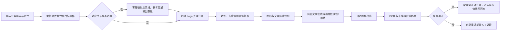
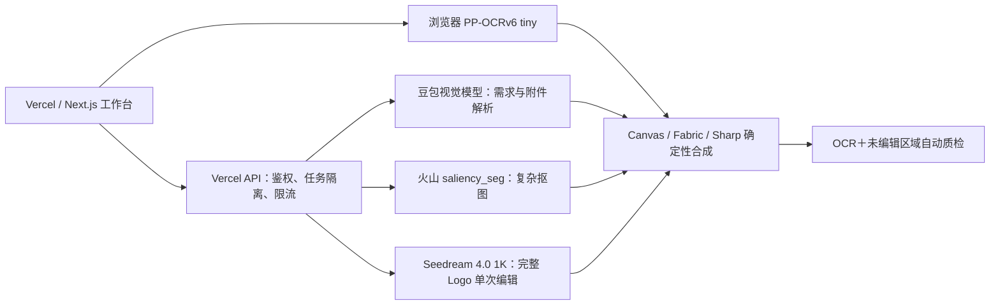

# 工作服效果图 Logo 自动预处理 PRD（P0）

- 文档版本：v0.8 单次完整 Logo 编辑稿
- 日期：2026-08-21
- 产品范围：客户 Logo 素材解析、处理与任务对应
- 依赖产品：工作服批量效果图 Demo
- 当前状态：独立 `/logo-studio` 已收缩为“1–2 张自动编号图片＋一句自然语言要求＋一个完整 Logo 结果”；用户可直接写“图1取 Logo、图2参考字体和颜色”，模型自动理解各图用途、图片位置、保留/删除内容、目标文字、颜色和排版；后台生成准确文字骨架，并将全部客户参考图、文字骨架和完整要求放入同一次 Seedream 图片调用，直接生成完整 Logo，Sharp 只负责去白底。结果仍是人工看图候选，文字自动门禁、复杂背景分割、结构保真校验、持久质检和任务回填尚未实现

## 1. 背景

客服在工作服效果图高峰期会同时处理约 7–8 个客户任务。客户上传的素材并不是统一的透明 Logo，常见情况包括：

- Logo 带白底、照片背景、手机界面、二维码或无关文案；
- 图形和文字组合在一起，但客户只要求修改文字；
- 要求 Logo 图形不变，文字根据衣服颜色换色；
- 要求替换或新增文字，并保持客户参考图中的字体视觉风格；
- 一项任务上传多张图片，不同图片分别承担主素材、字体参考、颜色参考或候选方案作用；
- 客户要求多个输出版本，但附件数量、指定对象和输出数量可能不一致。

现有 Demo 已支持上传 Logo、去近白底、手动移动缩放、批量绑定和导出，但不理解客户附件之间的关系，也不能自动完成图文分层、文字替换、局部换色和结果质检。客服仍需使用 Photoshop 手工整理 Logo，主要时间消耗发生在 Logo 预处理阶段。

## 2. 产品目标

P0 的目标是把客户原始图片和文字要求转换为可直接进入现有效果图画布的标准 Logo 素材，并保证任务与素材不串单。

### 2.1 目标

1. 自动识别每张附件在任务中的作用：主素材、字体参考、颜色参考、候选素材或排除素材。
2. 自动完成常见 Logo 清理：裁切、去背景、移除手机 UI、二维码和无关内容。
3. 在尽量保留原始图形像素的前提下，支持文字替换、新增文字、局部换色和相对大小调整。
4. 对新增或替换的文字实现“字体视觉相似”，不要求识别出字体名称。
5. 对文字准确性、未编辑区域和输出透明度执行自动质检。
6. 对附件对应关系或输出数量存在歧义的任务停止自动处理，交给客服确认。
7. 处理完成后输出透明 PNG，并绑定到正确的效果图任务。

### 2.2 成功定义

- 真实测试表中的 7 类任务均能进入正确状态：自动完成或明确要求人工确认。
- 所有标记为“可使用”的结果，目标文字必须与客户要求完全一致。
- 未要求修改的图形和文字不得被生成模型重画。
- 批量提交时不得发生跨任务附件、文字或输出结果串联。
- 客服从“逐个手工制作”转为“检查结果和处理少量异常”。

## 3. P0 范围

### 3.1 包含

- 客户任务文字要求解析；
- 多附件角色识别和任务对应；
- Logo 裁切、纯色/复杂背景移除；
- 手机界面、二维码、店铺环境和无关文案排除；
- 图形与文字区域识别；
- 图形与文字分别换色；
- 文字替换和新增；
- 字体视觉风格参考；
- 图形与文字分别缩放及相对排版；
- 同一 Logo 的多颜色、多文案变体；
- 透明 PNG 输出；
- 自动质检、失败回退和人工确认；
- 处理结果与现有效果图任务绑定。

### 3.2 不包含

- 根据款式字段自动选择服装；
- 自动判断 Logo 应放正面、背面、左胸或袖口；
- 自动确定 Logo 在衣服上的物理尺寸和最终坐标；
- 刺绣、丝印等工艺效果模拟；
- 建设或维护完整开源字体库；
- 正式多人数据库、对象存储和权限系统；
- 完全自动重绘低清、遮挡或信息缺失的品牌 Logo。

P0 处理结束后，客服仍通过现有效果图画布完成 Logo 在衣服上的位置和尺寸调整。

## 4. 核心原则

### 4.1 原图优先，局部生成

- 客户未要求修改的图形和文字直接保留原像素。
- 生成模型只允许处理需要新增或替换的文字小区域。
- 正式批量链路中，未修改区域仍以原像素或高清/SVG 源文件为真值；当前 Demo 支持 1–2 张低清参考图并采用一次完整图编辑作为实验路线，必须经人工核对，不能把模型结果视为像素级复刻。
- 换色、缩放和排版使用确定性图像处理，不使用生成模型。

### 4.2 字体视觉相似，不查字体名称

- 客户没有修改原文字时，直接保留原文字像素。
- 客户新增或替换文字时，根据参考图生成视觉风格相似的文字图层。
- P0 不接开源字体库，也不承诺识别出准确字体名称。
- 文字内容的准确性高于字体相似度；内容不准确时结果不得进入“可使用”状态。

### 4.3 歧义时停止，不自动猜测

出现以下情况时进入“需确认”：

- 多张图片都可能是主 Logo；
- 客户要求两个版本，但提供三个候选且未指定取舍；
- 目标文字无法从任务要求中唯一确定；
- 无法判断某张图片是主素材还是风格参考；
- 参考图片信息不足，模型只能凭空补全品牌内容。

## 5. 用户与使用流程

### 5.1 主要用户

- 客服/效果图制作人员：导入客户任务、检查解析结果、确认歧义、使用处理后的 Logo。
- 产品/技术人员：维护处理规则、模型路由和真实任务回归集。

### 5.2 标准流程



## 6. 输入与输出合同

### 6.1 输入

每个处理任务至少包含：

| 字段 | 必填 | 说明 |
| --- | --- | --- |
| 任务 ID | 是 | 与效果图任务一一对应，禁止跨任务复用解析结果 |
| 客户原始要求 | 是 | 保留原文，作为审计依据 |
| 附件列表 | 是 | 图片及其来源顺序 |
| 目标文字 | 条件必填 | 新增或替换文字时必须有唯一、精确的目标字符串 |
| 输出版本要求 | 是 | 需要输出几版、各版之间有何差异 |
| 人工补充说明 | 否 | 客服对主素材、参考图或保留区域的确认 |

### 6.2 附件角色

每张附件必须被标记为以下一种角色：

- `primary`：需要处理的主 Logo 素材；
- `font_reference`：只参考字体视觉风格；
- `color_reference`：只参考颜色；
- `candidate`：需要客服从多个候选中选择；
- `exclude`：手机 UI、二维码、门店环境或其他不参与输出的内容。

同一张图片可包含多个区域角色；多张图片时按图1/图2与用户原话建立用途对应，无法唯一判断 Logo、字体或颜色来源时必须转确认。

### 6.3 操作类型

- `crop`：裁切目标区域；
- `remove_background`：去除背景；
- `extract_region`：提取指定图形或文字区域；
- `remove_region`：移除二维码、UI 或无关内容；
- `replace_text`：替换原文字；
- `add_text`：新增文字；
- `recolor_graphic`：仅修改图形颜色；
- `recolor_text`：仅修改文字颜色；
- `resize_graphic`：仅修改图形相对大小；
- `resize_text`：仅修改文字相对大小；
- `compose`：按上下、左右等关系组合图形与文字；
- `create_variants`：按颜色、文案或候选要求生成多个输出版本。

### 6.4 输出

每个输出版本必须包含：

- 透明 PNG；
- 对应任务 ID 和版本 ID；
- 使用了哪些输入附件及附件角色；
- 实际执行的操作列表；
- 最终目标文字；
- OCR 校验结果；
- 未编辑区域校验结果；
- 自动完成、需确认或人工处理状态；
- 失败时可读的失败原因。

## 7. 功能需求

| ID | 功能 | 产品规则 | P0 验收 |
| --- | --- | --- | --- |
| `REQ-001` | 任务要求解析 | 从客户原文提取目标文字、保留内容、删除内容、颜色、相对大小和输出数量 | 解析结果可编辑且保留原始要求 |
| `REQ-002` | 附件角色识别 | 标记主素材、字体参考、颜色参考、候选和排除素材 | 每张附件均有角色、置信度和理由 |
| `REQ-003` | 对应关系确认 | 不明确时禁止进入自动处理 | 歧义任务进入“需确认”，不生成猜测结果 |
| `REQ-004` | 素材清理 | 支持裁切、白底/复杂背景移除及无关区域排除 | 输出透明背景，目标主体完整且无明显残留 |
| `REQ-005` | 图文区域识别 | 识别文字框和图形区域，为独立修改建立蒙版 | 文字和图形可分别换色或缩放 |
| `REQ-006` | 文字替换与新增 | 仅生成目标文字区域，字体视觉参考指定图片 | 文字完全正确；未改图形保持原像素 |
| `REQ-007` | 局部换色 | 支持整图、仅图形、仅文字换色 | 非目标图层颜色不得变化 |
| `REQ-008` | 相对大小和排版 | 支持图形小一点、文字大一点及上下/左右组合 | 调整可预览并可人工微调 |
| `REQ-009` | 批量变体 | 一个主 Logo 可产生多颜色、多文案或多候选版本 | 输出数量及版本标签与要求一致 |
| `REQ-010` | 自动质检 | 检查文字、透明度、裁切完整性和未编辑区域 | 未通过质检的结果不得自动进入画布 |
| `REQ-011` | 失败回退 | 自动处理失败后给出原因和建议动作 | 不静默失败，不把失败结果标记为完成 |
| `REQ-012` | 结果追溯 | 保存输入附件、解析合同、处理操作和质检报告 | 可从结果追溯到任务与原始附件 |

## 8. 真实任务、涉及需求与技术路线

| 真实任务 | 涉及需求 | 技术路线 |
| --- | --- | --- |
| 干净 Logo 图片，如“深圳怡鑫”，整理为可使用素材 | 去背景、裁切、原内容保持 | 纯色背景优先确定性去除；复杂背景调用现有显著性分割；输出透明 PNG，不重画 |
| 从组合图中提取图形，新增“汉方嘉铁永坊店”，参考蓝色并上下排版 | 区域理解、文字新增、字体视觉相似、参考色、排版 | Seed 2.0 Lite 理解保留/删除/颜色/排版；后台生成准确文字骨架；Seedream 4.0 1K 在一次请求中生成完整 Logo；人工复核图形保真与文字 |
| 一张素材中包含多个“暨南大学穗华口腔”版式 | 多候选、附件对应、原内容保持、歧义处理 | 视觉模型输出候选列表和预览；客服选择后才处理；原文字和图形直接保留 |
| 圆形人物图标加门店照片中的“侃侃家·红糖藕粉”文字 | 主素材和字体参考区分、排除门店背景、生成相似文字、组合 | 圆形图标标记为主素材；门店图只作字体参考；局部生成文字；OCR 精确校验 |
| 同一 Logo 用于黑、白、冰蓝等多个任务 | 批量变体、黑白换色、对比度适配 | 建立透明主 Logo；按规则确定性换色并批量导出，不重复生图 |
| 从手机截图/小程序码页面提取“酒利客”，增加“轻工业店” | 去 UI、去二维码、区域提取、文字追加、字体视觉相似 | Seed 2.0 Lite 先明确中心 Logo 与需排除的 UI/二维码；Seedream 4.0 1K 单次生成完整 Logo；OCR 与人工复核共同验收 |
| 提供三个幼儿园 Logo，但要求两版 | 多附件映射、输出数量、冲突处理 | 检测到“三候选、两输出”冲突后进入“需确认”，客服勾选两个候选 |
| 图形颜色不变，文字按衣服颜色改变 | 图文分层、仅文字换色、批量适配 | OCR 文字蒙版；锁定图形层；使用确定性像素换色 |
| “Logo 小一点、文字大一点” | 图形与文字独立缩放、相对布局保持 | 图形层和文字层分别记录边界框；使用画布变换，不调用生图模型 |
| 把原文字替换为“硕时托管中心”等新文字 | 删除旧文字、生成相似新文字、图形保持 | 清除旧文字区域；局部生成新文字；OCR 与未编辑区像素差双重验收 |
| Logo 来自门牌、杯子、奖牌或实拍照片 | 透视矫正、背景清理、低质量回退 | 透视矫正后提取主体；信息缺失或反光遮挡时转人工，不凭空补全 |

## 9. 技术路线

### 9.1 选型结论

本需求不存在一个模型可以完整解决。结合当前 Next.js/Vercel 部署、CatalogHub 现有依赖和火山引擎调用链，P0 采用“火山云端模型＋浏览器轻量 OCR＋确定性图像处理”的组合路线。Vercel 只承担接口编排和权限保护，不运行 Python/CUDA/GPU 模型。

| 环节 | 最终选型 | 部署方式 | 使用边界 |
| --- | --- | --- | --- |
| 任务与附件关系解析 | `doubao-seed-2-0-lite-260215` | 复用 CatalogHub 现有 Ark 云端 API | 只输出严格 JSON、置信度和待确认问题，不生成最终图片 |
| 纯色背景移除 | 现有浏览器像素算法 | 浏览器 Canvas | 适合白底、浅色纯底等简单素材，不产生模型费用 |
| 复杂背景移除 | 火山视觉 `saliency_seg` | 复用 CatalogHub 现有云端接口 | 继续作为主要复杂抠图链路，返回蒙版后由客户端合成原图 |
| 文字识别和质检 | `PP-OCRv6 tiny` 检测＋识别模型 | 浏览器 WASM/ONNX；检测与识别模型随 Demo 同源静态托管 | 编辑前定位文字，编辑后校验目标文字；约 6.3MB 模型资源首次加载，图片不上传 |
| 完整 Logo 单次编辑 | `doubao-seedream-4-0-250828`（Doubao-Seedream-4.0），固定 `1K` 输出 | 复用 CatalogHub 现有火山方舟云端 API | 当前 Demo 在一次图片请求中输入 1–2 张客户参考图与后台文字骨架，直接生成完整 Logo；Sharp 只去白底，不再拼接多张模型结果；结果需人工看图，不自动覆盖任务 |
| 换色、缩放和排版 | Canvas/Fabric/Sharp | 浏览器或现有 Node.js 运行时 | 必须确定性处理，不调用生成模型 |

### 9.2 最终图片编辑模型：Doubao-Seedream-4.0 1K

最终选择 `doubao-seedream-4-0-250828`（控制台名称 `Doubao-Seedream-4.0`）作为 P0 默认图片编辑模型，并固定请求 `1K`。Seedream 5.0 Pro 与 5.0 Lite 退出默认生成链路，只保留服务端环境变量覆盖能力；Qwen-Image-Edit、AnyText2 和 SAM2 仍不纳入 P0 线上运行链路。

选择原因：

- 当前专用 API Key 已完成该模型三次真实双图调用，接口 3/3 成功；
- 当前 Next.js 服务可复用已有 Ark 接口、密钥读取和错误处理方式，不引入新的云服务或 GPU；
- 当前主流程让分析模型先把自然语言转成保留、删除、文字、颜色和排版约束，再交给 Seedream 4.0 生成完整 Logo；同一真实任务连续三次目标文字、蓝色和上下排版均人工通过；
- 通过现有 Ark HTTPS API 调用，不需要在 Vercel、自有服务器或本地电脑部署 GPU；
- 统一使用火山引擎可减少新的供应商密钥、账单和网络链路。

当前部署状态：代码、`.env.example`、回归脚本和自动测试合同已切为 Seedream 4.0 1K。`cataloghub-logo-p0-20260819` 专用 API Key 已使用同一双图任务连续完成三次真实调用，模型耗时分别为 49.303、47.587、37.271 秒。4.0 不支持 `output_format` 参数，当前请求会按模型版本自动省略；5.0 覆盖请求仍发送该字段。

模型边界：

- Seedream 4.0 不负责确定性换色、缩放和排版；
- 当前简化页面允许 1–2 张参考图直接生图，以换取“图片＋一句话＋一个结果”的最短操作；因此不能保证未修改图形的像素完全不变；
- 模型输出不是事实来源，目标文字和保留内容仍以客户原始要求为准；分析模型无法唯一理解时停止生图；
- 一次只生成一个完整 Logo，不生成三个候选；后台仍自动生成目标文字骨架用于锁定字形，但不展示为操作步骤，也不要求用户拆图、填写目标文字或选择素材角色；
- 提示词不得包含候选编号、版本号等流程元数据，防止无关文字进入画面；
- 当前结果由客服直接看图确认；若未来要求自动写入任务，仍需恢复 OCR、未编辑区像素校验和透明背景门禁。

### 9.3 不接字体库的原因

- 客户大多只要求视觉风格相似，并未提供字体文件或字体名称；
- 逐个检索字体会引入字体授权、中文字符覆盖和部署体积问题；
- 即使找到相似字体，门店招牌和定制字形也不一定来自标准字体；
- 局部文字生成更符合当前真实需求。

若后续客户要求“必须使用指定字体并可继续编辑文字”，再独立评估字体识别、授权字体库和字体文件上传能力，不纳入 P0。

### 9.4 部署可行性与淘汰结论

以下结合 2026-08-19 模型调研、2026-08-21 Pro 验证、2026-08-22 Seedream 4.0 重复测试与 2026-08-23 默认模型切换：

| 模型/方案 | 是否进入线上方案 | 部署判断 |
| --- | --- | --- |
| `doubao-seed-2-0-lite-260215` | 是 | 已有 Ark API 接入，无新增运行时 |
| `doubao-seedream-4-0-250828` / Seedream 4.0 | 是，默认 | 2026-08-22 同一双图任务连续 3 次 HTTP 200，平均模型耗时 44.720 秒；目标文字、蓝色和上下排版 3/3 人工通过；请求不得发送该模型不支持的 `output_format`。字体笔触/字距波动且品牌图形仍被重绘，结果继续人工复核 |
| `doubao-seedream-5-0-pro-260628` / Seedream 5.0 Pro | 否（退出默认链路） | 账号和专用 Key 均已开通；保留 83 秒真实样例基线和服务端环境变量覆盖能力，不再作为默认生成模型 |
| `doubao-seedream-5-0-260128` / Seedream 5.0 Lite | 否（退出当前主链） | 已有真实调用基线，图生图/文生图 0.2200 元/张；稳定性未达到当前要求，不再作为默认生成模型 |
| `PP-OCRv6 tiny` | 是 | 已在 CatalogHub 使用浏览器 WASM；检测和识别资源合计约 6.3MB |
| 火山 `saliency_seg` | 是 | 已有线上接口和真实样本评测，继续复用 |
| Qwen-Image/Qwen-Image-Edit 自托管 | 否 | 20B 图像模型，官方本地示例使用 CUDA，并提供多 GPU 服务；不适合 Vercel |
| AnyText2 自托管 | 否 | 官方建议至少 8GB GPU；当前没有 GPU 服务，不引入 |
| SAM2 自托管 | 否 | 依赖 Python、PyTorch、TorchVision 和 CUDA 编译链；不适合 Vercel |
| rembg/BiRefNet 自托管 | 否 | 既有 12 样本评测未达到替换门槛，且内存不满足当前部署条件 |

### 9.5 线上部署结构



部署约束：

- Vercel 不安装 Python、PyTorch、CUDA 或任何大模型权重；
- Ark API Key 和火山 Access Key/Secret Key 只保存在服务端环境变量，不下发浏览器；
- PP-OCRv6 在浏览器 Web Worker 中运行，避免占用 Vercel 函数内存；
- PP-OCRv6 的检测、识别模型固定存放于 `public/ocr-models/`，使用一年 immutable 缓存；实测第三方百度模型源在浏览器会因网络/CORS 返回 `net::ERR_FAILED`，因此线上不得依赖跨域即时下载；
- 透明 Logo 在 OCR 前分别合成白色和黑色对比底；白底结果不通过时再检查黑底，任一结果达到精确文字与置信度门槛才允许自动通过；
- 一次提交 8 个任务时由服务端限制并发，单任务上下文和输出完全隔离；
- Demo 阶段可把最终 PNG 保存到当前浏览器 IndexedDB；正式多人版必须写入对象存储，不能依赖 Seedream 返回的临时 URL；
- 2026-08-19 已在火山 Default 项目创建 `cataloghub-logo-p0-20260819` 专用 API Key；2026-08-21 已在保留 Doubao-Seedream-5.0-lite 与 Doubao-Seed-2.0-lite 的同时新增 Doubao-Seedream-5.0-pro，并回读确认三项权限；Key 已写入 CatalogHub 服务端 `.env.local` 的 `ARK_RUNTIME_API_KEY`，不得暴露给浏览器或写入仓库；
- Pro 权限传播后真实请求进入模型参数校验；移除不支持的 `sequential_image_generation` 后，Pro 1K 真实请求 HTTP 200，端到端 83 秒；
- 2026-08-19 充值后账户余额已恢复为正，欠费阻塞已解除；使用专用 Key 完成两次 Seedream 5.0 Lite 真实图片生成调用，耗时分别为 30.183 秒和 18.625 秒。
- 实测 Seedream 返回的是白底 JPEG，即使提示词要求透明背景也不能作为透明 PNG 直接使用；线上链路必须在模型输出后执行确定性文字蒙版提取、参考色重着色和透明图层合成。
- 2026-08-21 已增加服务端 `POST /api/logo-studio`：Key 只从服务端 `ARK_RUNTIME_API_KEY`（回退 `ARK_API_KEY`）读取，浏览器不接触密钥；当前仍是内部 Demo，同步接口尚未补用户鉴权、限流、持久任务和生产队列。

## 10. 页面和交互要求

Logo 修改是独立于衣服商品选择和位置调整的前置工作，因此采用专门页面 `/logo-studio`。顶部导航和 `/workbench` 当前任务设置区均提供明显入口；用户无需先选择衣服或上传到某个制作位置。

### 10.1 一至两图与自然语言输入区（已实现）

展示：

- 一次上传 1–2 张客户图片，可分次添加或移除；页面按上传顺序自动标记图1、图2；
- 用户无需选择素材角色，直接在一句要求中写“图1取 Logo、图2参考字体/颜色”；
- 只提供一个“你希望怎么改”的自然语言输入框；
- 用户可直接写“中间的 Logo＋汉方嘉铁永坊店【上下排版，文字颜色用下图文字的那个蓝色】”；
- 不再要求选择主素材、文字参考、颜色参考，不再重复填写目标文字，不再选择单行/双行；
- 图片或修改要求任一为空时，“理解并生成一个完整 Logo”不可用。

替换图片会清空旧结果；客户端与服务端都校验图片类型、大小和自然语言要求，防止空请求进入模型。

### 10.2 模型理解与单结果生成区（已实现）

点击开始后执行：

1. `doubao-seed-2-0-lite-260215` 同时读取客户图片和自然语言要求；
2. 理解“顶部、中间、底部、左边、右边”等位置词，返回要保留的元素、要删除的元素、图片可见文字、最终目标文字、颜色参考和图文排版；
3. 取图位置、目标文字、颜色或排版无法唯一确定时显示“需要补充确认”，不调用生图模型；
4. 无歧义时，把全部客户参考图、目标文字骨架和结构化编辑指令在同一次请求中交给 `doubao-seedream-4-0-250828`，固定输出 `1K`；
5. Seedream 只生成一个居中的完整 Logo，不输出衣服、门店、界面、说明、序号或多个候选；
6. 服务端下载临时结果，以页面可下载图片返回。

当前页面展示：

- 模型理解的保留元素和删除元素；
- 从用户原话提取的新文字、颜色参考和排版；
- 待确认问题；
- 一个完整 Logo、模型 ID、耗时和下载按钮。

### 10.3 最终结果区（单结果已实现，自动门禁待补）

每个版本展示：

- 透明背景预览；
- 处理前/处理后对照；
- 实际执行操作；
- OCR 结果；
- 质检状态；
- 当前已实现“下载这个 Logo”；“使用此 Logo”“重新处理”“转人工”、OCR/像素门禁和质检记录持久化待补。

点击“使用此 Logo”后，把结果绑定到当前任务，继续使用现有画布完成衣服位置和大小调整。

### 10.4 状态

- `待解析`：尚未分析附件；
- `需确认`：存在对应关系或输出数量歧义；
- `处理中`：处理任务已提交；
- `待质检`：图片已生成，正在执行 OCR 和像素校验；
- `可使用`：全部自动门禁通过；
- `需人工`：无法可靠自动完成；
- `处理失败`：服务或数据错误，显示具体原因。

## 11. 数据合同建议

P0 在现有 `MockupTask` 之外增加 Logo 处理任务，不直接破坏当前 `placements` 合同。处理完成并经客服确认后，才把最终 PNG 写入现有 `LogoPlacement.logoUrl`。

```ts
type LogoProcessingJob = {
  id: string;
  mockupTaskId: string;
  originalRequirement: string;
  targetTexts: string[];
  requestedVariantCount: number;
  inputs: Array<{
    id: string;
    imageUrl: string;
    role: 'primary' | 'font_reference' | 'color_reference' | 'candidate' | 'exclude';
    confidence: number;
  }>;
  operations: Array<{
    type: string;
    inputIds: string[];
    targetText?: string;
  }>;
  status: 'pending' | 'needs_confirmation' | 'processing' | 'ready' | 'manual' | 'failed';
  outputs: Array<{
    id: string;
    imageUrl: string;
    label: string;
    ocrPassed: boolean;
    unchangedRegionPassed: boolean;
  }>;
  failureReason?: string;
};
```

## 12. 自动质检与验收门禁

### 12.1 必须自动验证

1. **文字准确性**：自动通过的结果中，OCR 规范化文本必须与目标文字完全一致；规范化只执行 Unicode NFKC 和空白移除，不删除句号、中点等有业务意义的标点。
2. **未编辑区域**：编辑蒙版之外使用原始像素合成，不允许生成模型改动。
3. **主体完整性**：Logo 主体不得被裁断，独立小部件不得丢失。
4. **背景透明度**：要求去背景时，输出必须包含有效 Alpha 通道，不得保留整块白底或照片背景。
5. **输出数量**：实际版本数量必须与经确认的版本数量一致。
6. **任务隔离**：输出的任务 ID、目标文字和附件来源必须全部属于同一任务。
7. **识别置信度**：参与精确匹配的 OCR 文字行最低置信度不得低于 0.65；无文字、文字不一致、低置信度、模型资源失败或单次识别超过 30 秒均不得自动通过。

### 12.2 人工视觉验收

字体视觉相似采用五级评价：

- 5：笔画、粗细、倾斜、圆角和整体气质高度接近；
- 4：存在轻微差异，但普通客户不会认为是不同风格；
- 3：文字正确，但明显只是普通字体；
- 2：风格差异较大；
- 1：文字错误或不可用。

P0 自动结果必须达到 4 分或以上；低于 4 分转人工，不因为文字 OCR 正确而自动通过。

### 12.3 性能目标

- 支持一次提交至少 8 个任务，并保持任务与附件完全隔离；
- 单任务自动链路目标 P95 不超过 90 秒，不包含人工确认时间；
- 性能目标不得以降低文字准确性和原图保持为代价。

## 13. 真实任务回归集

首批固定回归集使用客户任务表中的 7 个任务及其 10 张原始附件，不使用重新制作的理想素材替代。

| 用例 | 预期结果 |
| --- | --- |
| `AT-001` 干净 Logo | 自动输出透明 PNG，原内容不变 |
| `AT-002` 提取图形并新增文字 | 文字正确、字体风格相似、图形不变、参考色正确 |
| `AT-003` 多个口腔 Logo 版式 | 展示候选并要求选择，不自动猜测 |
| `AT-004` 图标加门店文字参考 | 正确区分主素材与字体参考，排除门店环境 |
| `AT-005` 同 Logo 多颜色任务 | 共用一个主素材，生成对应颜色变体，不重复生图 |
| `AT-006` 手机截图加小程序码 | 排除手机 UI 和二维码，只保留目标 Logo 并追加正确文字 |
| `AT-007` 三个候选但要求两版 | 明确进入“需确认”，选择后只输出两版 |

另外使用客户反馈截图补充以下回归：文字单独换色、图形小文字大、替换为“硕时托管中心”、实拍门牌/奖牌 Logo 提取。

### 13.1 2026-08-19 首轮真实任务结果

本轮直接读取客户原始 Excel，确认共有 7 条任务、10 张嵌入附件。测试产物和非密钥调用回执保存在本地 `research-runs/logo-p0-20260819/`，该目录不进入 Git。

| Excel 任务 | 涉及需求 | 本轮技术路线 | 实测状态与结论 |
| --- | --- | --- | --- |
| 第 2 行：左胸使用图一 | 白底去除、原内容保持 | 原图裁边＋确定性白底去除 | **预处理通过**：已生成透明 PNG，未调用模型；最终上衣效果图尚未验证 |
| 第 3 行：中间图形＋“汉方嘉铁永坊店”，参考蓝色，上下排版 | 图文分层、精确文字、字体视觉相似、参考色、排版 | 原图图形像素保留；Seedream 仅生成文字字形；采样参考色重着色；透明合成 | **首轮可用**：人工逐字核对为“汉方嘉铁永坊店”，原图形未交给模型，输出透明；后续浏览器 OCR 门禁已通过，见 13.2 |
| 第 4 行：左胸使用图一 | 白底去除、组合标识保持 | 原图裁边＋确定性白底去除 | **预处理通过**：整张标识内容已保留并生成透明 PNG，未调用模型 |
| 第 5 行：卡通 Logo＋“侃侃家.红糖藕粉” | 主素材与字体参考对应、精确文字、字体视觉相似 | 先确认目标文字，再局部生成文字并合成卡通原图 | **需确认，未调用模型**：任务文字使用半角句点 `.`，门店参考图使用中点 `·`，不能自动猜测最终标点 |
| 第 6 行：同一 Logo 用于多个颜色任务 | 白底去除、共用主 Logo、后续颜色适配 | 建立一份透明主 Logo；具体衣服颜色适配在效果图阶段确定性处理 | **主 Logo 预处理通过**：已生成透明 PNG，未调用模型；款式字段按当前 P0 约定暂不处理 |
| 第 7 行：从小程序码截图提取“酒利客”并增加“轻工业店” | 排除 UI/二维码、保留原 Logo、精确新增文字、字体视觉相似 | 裁切原始中心 Logo；Seedream 仅生成“轻工业店”；采样原字颜色后透明合成 | **需人工复核**：新增文字人工逐字核对正确，未重画原 Logo；但客户只提供低清截图，原“酒利客”清晰度不足，不能自动标记最终通过 |
| 第 8 行：两个款式各做一版，但附三张图 | 多附件对应、输出数量、歧义安全回退 | 阻止生图，先展示三张候选让客服指定两张及对应关系 | **需确认，未调用模型**：3 张附件无法唯一映射到 2 个输出 |

本轮形成的确定结论：

- 3 条简单白底任务应优先使用确定性去底，不产生生成模型费用；
- 2 条文字任务证明 Seedream 5.0 Lite 可用于“参考字形生成新文字”，但不能负责透明背景和精确颜色；
- 客户原图形必须裁切保留，不能让模型重画；
- 2 条歧义任务必须在调用模型前停止，避免花费和错单；
- 2026-08-19 的文字结论最初来自人工核对；2026-08-20 已补充 PP-OCRv6 自动门禁正反例，见 13.2。

### 13.2 2026-08-20 浏览器 OCR 门禁结果

工作台“当前任务设置”已增加 Stage 0 文字验收入口。用户输入客户要求的完整文字后，浏览器本地运行 PP-OCRv6 tiny，并显示识别文字、最低置信度、对比底色和推理耗时；结果当前只用于验证，不自动写入任务状态。

| 真实检查 | OCR 结果 | 门禁结论 |
| --- | --- | --- |
| `xlsx-r3-final-logo-v1.png`，目标“汉方嘉铁永坊店” | 白色对比底识别为“汉方嘉铁永坊店”，最低置信度 100%，推理 377ms | **自动通过** |
| 同一图片输入错误目标“汉方嘉铁永坊点” | OCR 文字与目标不一致 | **正确拦截**，进入人工 |
| `xlsx-r2-simple-cutout.png`，目标“深圳怡鑫” | 生产构建 `next start` 下黑色对比底识别为“深圳怡鑫”，最低置信度 100%，推理 660ms | **自动通过** |
| `xlsx-r7-final-logo-v1.png`，目标“酒利客轻工业店” | 识别为“酒 酒利客 轻工业店”，最低置信度 95%，推理 761ms | **正确转人工**：Logo 图形中心本身含“酒”字，全图严格匹配不能判断这是允许的原图内容 |

这轮实测进一步收口了门禁边界：

- 透明 Logo 必须先合成对比底，否则深色文字可能在透明黑底上误识别；
- 全图 OCR 适合干净字标，但组合 Logo 可能把图形内的字也识别出来；正式自动链路应优先检查“生成文字图层”，再用原图 OCR 基线确认未新增非目标文字；
- 不能为了提高自动通过率把“完全一致”降级为“包含目标文字”，否则模型多生成文字时会误放行；
- 浏览器门禁已经可运行，但 OCR 结果尚未持久化到 `STORE-004`，不代表完整异步预处理流程完成。
- 生产构建已验证 `/workbench` 和两份同源 OCR 模型资源均返回 HTTP 200，模型资源携带 `public, max-age=31536000, immutable`，并在该构建中完成一次真实文字通过测试。

### 13.3 2026-08-21 独立 Logo 智能处理页面结果

页面已根据客服实际输入方式收缩为最短链路：上传 1–2 张自动编号图片，输入一句自然语言，直接生成一个完整 Logo。当前已验证单图样本为同一张图中从上到下包含红色“白云山”、中间蓝色图形和底部蓝色“维一实业”，用户原话为：

> 中间的logo+汉方嘉铁永坊店【上下排版，文字颜色用下图文字的那个蓝色】

实际结果：

| 阶段 | 结果 |
| --- | --- |
| 页面输入 | 1 个可选择最多两张图片的输入、1 个自然语言文本框、0 个角色/排版下拉框；至少一张图片与要求填全后按钮可用；图片显示图1/图2标签 |
| 页面理解目标 | 保留中间蓝色图形；删除顶部红字和底部旧文字；新增“汉方嘉铁永坊店”；图形在上、文字在下；文字取底部旧字的蓝色 |
| 自动测试 | 7 个测试文件、27 项测试通过；覆盖单/双图输入、0 张与超过 2 张拦截、图1/图2分析对应、两张参考图＋文字骨架的单次 Seedream 4.0 1K 默认请求合同、4.0 不发送 `output_format`、5.0 覆盖请求发送该字段和上游错误脱敏 |
| 双图页面验收 | 2026-08-22 浏览器实测可一次选择 2 张 PNG，自动显示图1/图2；达到上限后禁止继续添加，填写图号对应要求后生成按钮启用；未用页面截图执行付费生图 |
| 真实请求 | `doubao-seed-2-0-lite-260215` 负责理解，`doubao-seedream-4-0-250828` 在同一次图片调用中接收原图与文字骨架，固定 `1K`；同一真实双图任务连续三次 HTTP 200，平均模型耗时 44.720 秒 |
| 生图结果 | 目标“汉方嘉铁永坊店”逐字正确，颜色与原底部蓝色一致，字体明显接近手写/书法风格；中间品牌图形仍出现线宽、负形和比例偏移 |
| 当前结论 | Seedream 4.0 1K 已替换为默认模型；文字、颜色和排版的单案例重复稳定性已验证，但品牌 Logo 高保真门禁仍未通过。缺少高清原图或 SVG 时必须人工核对，不能把“生成成功”当作 Logo 保真验收通过 |

Seedream 4.0 实测（2026-08-22）：使用与当前页面一致的双图输入和要求，连续 3 次成功，模型耗时 49.303、47.587、37.271 秒，平均 44.720 秒；三张均逐字生成“汉方嘉铁永坊店”，并保持蓝色、手写/书法方向及图上字下布局。它在该单一案例上比 Pro 的既有 83 秒样例更快、单张标价更低，但三次笔触、字距和 Logo 负形并不一致，不能据此认定品牌保真稳定。2026-08-23 按用户决定切换为默认模型，人工复核边界不变；证据见 `research-runs/seedream-4-0-20260822/outputs/summary.json` 与 `contact-sheet.png`。

此前的“显式填写目标文字＋选择排版＋三候选”交互已从当前页面移除：它能做文字门禁，却让客服承担过多操作并且只返回孤立文字层。当前仅在后台复用目标文字骨架，并将 1–2 张客户参考图与骨架一起交给同一次图片生成，直接返回一个完整 Logo。

## 14. 发布门禁

### 阶段 0：选定模型接入验证

- 已把默认图片模型、回归脚本和自动测试合同切换为 `doubao-seedream-4-0-250828`＋`1K`，不进行线上自动多模型路由；专用 Key 已完成同一双图任务三次真实调用；
- 使用客户 7 个任务及补充文字案例验证目标文字、字体视觉评分、未编辑区域和处理时间；
- 单个结果未达到门禁时转人工，不自动切换到另一个生成模型；
- 只有通过自动门禁的结果才允许客服点击“使用此 Logo”。
- 当前阶段 0 **尚未完整通过**：最短交互、Seedream 4.0 1K 默认代码合同和三次真实生成已完成；当前客户样本的文字正确且字体风格改善，但品牌图形仍有生成式偏移。其余真实任务仍需回归，并在自动写入任务前补区域级 OCR、复杂背景分割、未编辑区像素门禁和持久化质检记录。
- 2026-08-20 已完成 PP-OCRv6 工作台入口、同源模型资源和真实浏览器正反例验证。
- 2026-08-22 页面已放开到 1–2 张自动编号图片；后台只保留一个隐藏文字骨架，并与全部客户参考图一起放入同一次 Seedream 4.0 请求直接生成完整 Logo，页面仍是一句话、一个结果。
- 2026-08-22 已完成 Seedream 4.0 单案例三次重复测试：接口 3/3 成功且目标文字 3/3 人工正确，但字形与品牌图形仍有生成波动；2026-08-23 按用户决定替换默认 Pro，正式结果继续要求人工核对。

### 阶段 1：客服辅助试用

- 只生成预览，不自动覆盖现有 Logo；
- 所有结果由客服点击“使用此 Logo”后才进入画布；
- 收集每个任务的自动完成、人工修正和放弃原因。

### 阶段 2：批量任务试用

- 支持 8 个任务排队处理；
- 验证无串单、无错误自动完成状态；
- 达到真实任务验收后再讨论默认开启。

## 15. 现有 Demo 差距

| 现有能力 | 当前状态 | P0 需要补充 |
| --- | --- | --- |
| Logo 上传 | `/logo-studio` 已实现单张 JPG/PNG/WebP 上传和替换 | 后续持久化原附件和客户原始要求 |
| 去背景 | 当前单结果页面不做自动去底 | 自动写入任务前增加透明背景和主体完整性检查 |
| 画布调整 | 已实现整体 Logo 移动、缩放和旋转 | 单结果经确认后接入现有 Logo 画布 |
| 批量设置 | 已实现同一 Logo 绑定多个任务 | 增加多颜色、多文字版本生成和对应关系 |
| 导出 | 已实现 Canvas PNG/ZIP 导出 | 只允许使用已通过 Logo 质检的素材 |
| 模型解析与生图 | 已实现 1–2 张编号图片的自然语言理解、歧义停止、一个完整 Logo 生成和下载 | 增加异步队列、用户鉴权、限流、重试和持久记录 |
| 任务状态 | 效果图任务仍为待上传、可导出、已导出；Logo 页面当前只有页面内状态 | 增加需确认、处理中、需人工和处理失败的持久状态 |

## 16. 暂不阻塞 P0 的后续问题

- 正式版是否把原始附件、蒙版和结果迁移到对象存储；
- 是否需要对接企业微信任务消息自动导入；
- 是否需要保留可编辑的文字对象，而不只是透明 PNG；
- 字体授权和指定字体文件上传是否会成为正式需求；
- 后续是否自动把已处理 Logo 映射到正面、背面及具体制作位置。

## 17. 技术参考

- Doubao-Seedream-5.0-pro 火山方舟体验页：[https://console.volcengine.com/ark/region:cn-beijing/experience/gen_image?model=doubao-seedream-5-0-pro-260628](https://console.volcengine.com/ark/region:cn-beijing/experience/gen_image?model=doubao-seedream-5-0-pro-260628)
- PaddleOCR：[https://github.com/PaddlePaddle/PaddleOCR](https://github.com/PaddlePaddle/PaddleOCR)
- Qwen-Image（仅作为未采用方案的部署依据）：[https://github.com/QwenLM/Qwen-Image](https://github.com/QwenLM/Qwen-Image)
- AnyText2（仅作为未采用方案的部署依据）：[https://github.com/tyxsspa/AnyText2](https://github.com/tyxsspa/AnyText2)
- SAM2：[https://github.com/facebookresearch/sam2](https://github.com/facebookresearch/sam2)
- BiRefNet：[https://github.com/ZhengPeng7/BiRefNet](https://github.com/ZhengPeng7/BiRefNet)
- rembg：[https://github.com/danielgatis/rembg](https://github.com/danielgatis/rembg)
